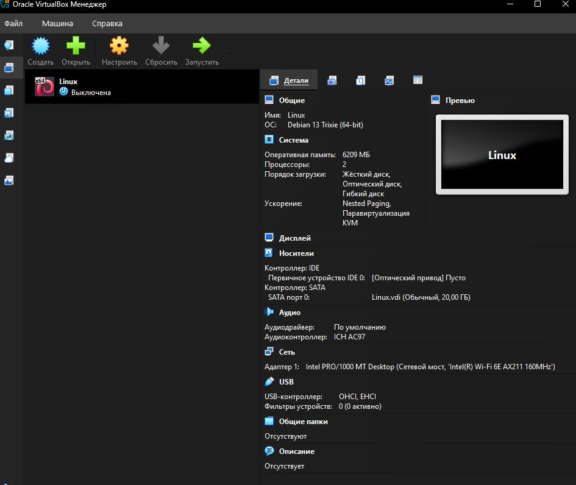
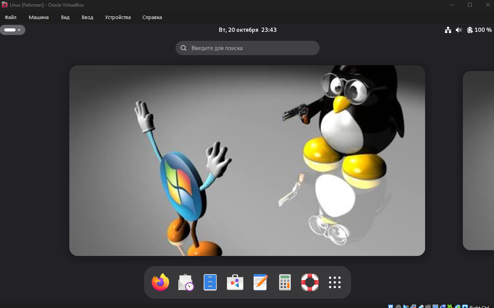
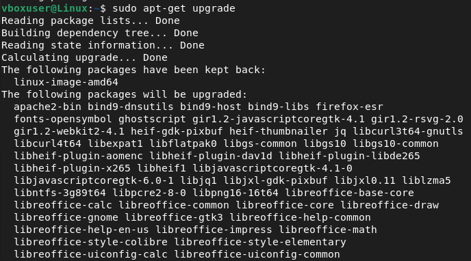
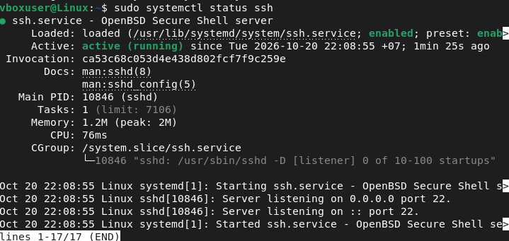
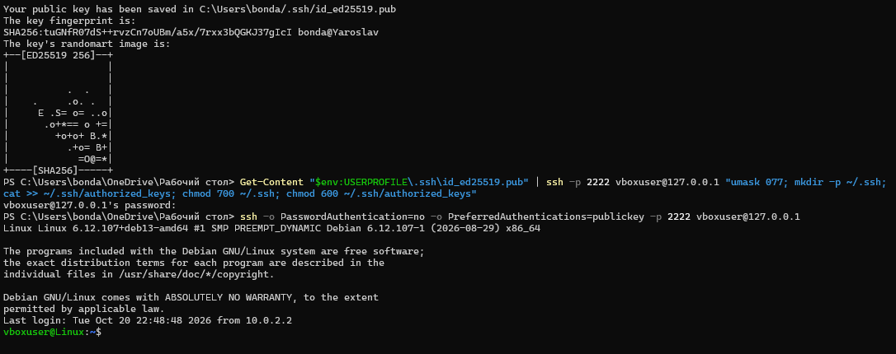

# debian-virtualbox-lab
Introduction to Virtual Machines and Debian Installation

# Лабораторная работа: Введение в виртуальные машины и установка Debian

## Цель работы

Создать виртуальную машину в Oracle VirtualBox, установить операционную систему Debian, выполнить обновление системы, настроить SSH-сервер и проверить удалённое подключение с использованием пароля и SSH-ключа.

## Используемые инструменты

- Oracle VirtualBox
- Debian Linux
- Windows PowerShell
- OpenSSH
- SSH-ключ Ed25519

## 1. Создание виртуальной машины

В Oracle VirtualBox была создана виртуальная машина для установки Debian. Был выбран ISO-образ Debian и настроены параметры оперативной памяти и виртуального диска в соответствии с требованиями лабораторной работы.



## 2. Установка Debian

Debian был установлен из ISO-образа. Во время установки были настроены параметры системы, создан пользователь и задан пароль. После завершения установки виртуальная машина успешно загрузилась.

**Скриншот 2. Запущенная система Debian**



## 3. Обновление системы

Для обновления списка пакетов и установки доступных обновлений были выполнены команды:

```bash
sudo apt-get update
sudo apt-get upgrade
```

Команда `apt-get update` обновляет список доступных пакетов, а `apt-get upgrade` устанавливает доступные обновления



## 4. Установка и запуск SSH-сервера

Для организации удалённого доступа был установлен OpenSSH Server:

```bash
sudo apt-get install openssh-server
```

Затем SSH-сервер был включён и запущен:

```bash
sudo systemctl enable --now ssh
sudo systemctl status ssh
```

Служба SSH находилась в состоянии `active (running)`, что подтверждает её успешный запуск.




## 5. Подключение по SSH с использованием пароля

В настройках сети VirtualBox для режима NAT было настроено перенаправление порта хоста `2222` на порт `22` виртуальной машины.

С Windows было выполнено подключение к Debian командой:

```powershell
ssh -p 2222 vboxuser@127.0.0.1
```

Подключение прошло успешно, и появилась командная строка пользователя Debian.




## 6. Результаты работы

В ходе лабораторной работы была создана виртуальная машина в Oracle VirtualBox и установлена операционная система Debian. Система была обновлена, установлен и запущен SSH-сервер. Удалённое подключение через NAT было успешно проверено с использованием пароля и SSH-ключа Ed25519.
